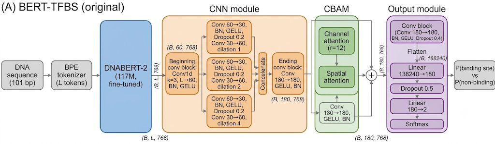
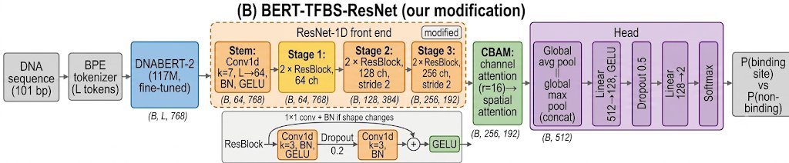

# BERT-TFBS Reproduction and Extensions

**CHE 629 course project **

Predicting transcription factor binding sites (TFBSs) from DNA sequence with a DNABERT-2 + CNN + CBAM model. We reproduce the published BERT-TFBS model and its ablations, fix gaps in the original evaluation code, and extend it with:
1. A **ResNet-1D** front end
2. A **synthetic planted-motif** study
3. A **cross-cell-line study** on CTCF (K562 and A549)
4. A **DanQ** baseline

> **Attribution:** This project builds on BERT-TFBS by Zeng et al. (*Briefings in Bioinformatics*, 2024, [DOI 10.1093/bib/bbae195](https://doi.org/10.1093/bib/bbae195)). Original code: [https://github.com/ZX1998-12/BERT-TFBS](https://github.com/ZX1998-12/BERT-TFBS). The files `script/model.py`, `model_V1.py`, `model_V2.py`, `CBAM.py`, `dataloader.py`, `adjust_learning.py`, `train.py`, `test_original.py` and `Dataset/.../pre_data.py` come from the original authors. The original repository shows no license, so credit the authors and ask them before redistributing their code or weights. Everything listed under "What we did" is ours.

---

## 1. Task

**Binary classification:** given a DNA sequence, does it contain a binding site for a given transcription factor?

* **Positives:** sequences centred on ENCODE ChIP-seq peaks.
* **Negatives:** random permutations of the positive sequence, which keep the nucleotide frequencies (the protocol of Zeng et al., 2016).
* **Split:** about 80% train / 20% test per dataset.

---

## 2. What we did

| # | Work | Where |
|---|---|---|
| 1 | **Reproduction.** Retrained BERT-TFBS (full), v1 and v2 on HepG2 FOSL2 with the paper's training recipe. | `train_metrics.py`, `test.py` |
| 2 | **Fixed evaluation.** Added `model.eval()` / `torch.no_grad()`, loss logging, seeds, and precision, recall, specificity, F1, MCC, ROC-AUC, PR-AUC and the confusion matrix. | `train_metrics.py`, `test.py`, `script/metrics.py` |
| 3 | **Novelty 1:** ResNet-1D front end replacing the CNN module. | `script/model_resnet.py` |
| 4 | **Novelty 2:** Synthetic planted-motif data with JASPAR motifs, size-matched to the FOSL2 dataset. | `make_synth.py`, `synth/` |
| 5 | **Novelty 3:** Cross-cell-line study on CTCF: train on one cell line, test on another. | `test_cross_cell.py`, `Dataset/` |
| 6 | **External baseline:** DanQ (CNN + BiLSTM, one-hot input). | `script/model_danq.py`, `train_baseline.py` |
| 7 | **Reproducible environment** (Python 3.9, torch 1.12.0 + CUDA 11.3, Docker). | `Dockerfile`, `docker-compose.yml`, `requirements.txt` |

---

## 3. Architecture

### (A) Original BERT-TFBS



* **DNABERT-2** (117M parameters, fine-tuned) encodes the tokenized sequence into $(B, L, 768)$.
* **CNN module:** Beginning conv block ($L \to 60$ channels), three parallel two-layer branches (dilation 1, 2, 4), concatenation (180 channels) and an ending conv block. The convolution runs along the 768-dimensional axis, with the $L$ tokens as input channels.
* **CBAM:** Channel attention (reduction 12) then spatial attention, with a Conv $180 \to 180$ skip path added back.
* **Output module:** Conv block, flatten (138,240 values), Linear $138,240 \to 180$, Dropout 0.5, Linear $180 \to 2$, softmax.

### (B) BERT-TFBS-ResNet (our modification)



| Component | Original | Ours (`--arch resnet`) |
|---|---|---|
| **Front end** | Beginning conv, 3 dilated parallel branches, ending conv | Stem (Conv $k=7, 64\text{ ch}$) + 3 stages of 2 ResBlocks ($64, 128, 256\text{ ch}$; stride 2 in stages 2 and 3) |
| **Length after front end** | 768 | 192 |
| **CBAM** | reduction 12, conv skip path | reduction 16, no skip path |
| **Output module** | conv block, flatten (138,240), 2-layer MLP | global avg + max pooling (512), Linear $512 \to 128$, GELU, Dropout 0.5, Linear $128 \to 2$ |

* **Shape flow of the ResNet variant:**
  $$(B, L, 768) \to (B, 64, 768) \to (B, 128, 384) \to (B, 256, 192) \to (B, 512) \to (B, 2)$$

> *Note:* The ResNet variant changes both the front end and the output head, so differences from the original cannot be attributed to the ResNet front end alone.

---

## 4. Datasets

| Folder | Source | Window | Train / test rows | Used for |
|---|---|---|---|---|
| `Dataset/wgEncodeAwgTfbsHaibHepg2Fosl2V0416101UniPk` | HepG2 FOSL2 (original authors' data, archived in `original_Dataset.zip`) | 101 bp | 39,439 / 9,920 | reproduction, ResNet, DanQ, ablations |
| `Dataset/wgEncodeAwgTfbsBroadK562CtcfUniPk` | K562 CTCF (Broad), built with `generate_dataset.py` | 200 bp | 83,187 / 20,797 | cross-cell study |
| `Dataset/wgEncodeAwgTfbsHaibA549Ctcfsc` | A549 CTCF (HAIB), built with `generate_dataset.py` | 200 bp | 65,345 / 16,337 | cross-cell study |
| `synth/FOSL2_r0.1_matched` | synthetic, see Section 5.2 | 101 bp | 39,440 / 9,920 | synthetic study |

### Notes on the data
* The CTCF datasets were built by us from ENCODE narrowPeak files (`Dataset/.../generate_dataset.py`): a 200 bp window centred on each peak, plus one random permutation of it as the negative. They therefore differ from the paper's 101 bp data, and their numbers are not directly comparable with the paper.
* K562 and A549 CTCF come from different labs (Broad vs HAIB), so a cross-cell comparison also mixes lab and antibody effects.
* The FOSL2 folder's `train.csv` / `test.csv` currently hold the K562 CTCF files (identical content). The original FOSL2 files are in `original_Dataset.zip` in the same folder. The FOSL2 results below were obtained on the original 101 bp data (9,920 test rows). Unzip it to reproduce them.

---

## 5. Experiments

All runs use seed 41 only. Epoch counts differ between runs (see the tables).

### 5.1 Reproduction and ResNet on HepG2 FOSL2 (101 bp, 9,920 test rows)

| Model | Epochs | Accuracy | ROC-AUC | PR-AUC | F1 | MCC |
|---|---|---|---|---|---|---|
| **BERT-TFBS (full)** | 10 | 0.8878 | 0.9449 | 0.9422 | 0.8858 | 0.7756 |
| **BERT-TFBS-v1** (no CNN / CBAM) | 15 | 0.8905 | 0.9364 | 0.9172 | 0.8879 | 0.7811 |
| **BERT-TFBS-v2** (no CBAM) | 10 | 0.8860 | 0.9451 | 0.9390 | 0.8827 | 0.7722 |
| **BERT-TFBS-ResNet** (ours) | 10 | 0.8859 | 0.9457 | 0.9494 | 0.8829 | 0.7720 |
| **DanQ** (one-hot CNN + BiLSTM) | 10 | 0.8310 | not valid* | not valid* | 0.8242 | 0.6628 |

*\* The DanQ model outputs logits, while `MetricTracker` expects class probabilities, so its ROC-AUC and PR-AUC in `results/test_danq_seed41.csv` are incorrect. Accuracy, F1 and MCC are not affected.*

> *For context, the paper reports averages over 165 datasets of accuracy / ROC-AUC / PR-AUC: full 0.851 / 0.919 / 0.920; v2 0.844 / 0.906 / 0.904; v1 0.838 / 0.887 / 0.872. These are averages over many datasets and are not comparable with a single dataset.*

### 5.2 Synthetic planted-motif study

`make_synth.py` generates random DNA (GC 0.5, 101 bp) and plants one JASPAR 2024 motif per positive sequence at a random position and strand, with a configurable per-base mutation rate. The negative is a permutation of the positive (`--neg shuffled`, the paper's protocol) or a fresh background sequence (`--neg background`). Each positive and its negative are generated as a pair and kept in the same split.

Dataset in the repo: `synth/FOSL2_r0.1_matched` — FOSL2 motif (JASPAR MA0478.1), mutation rate 0.1, shuffled negatives, sizes matched to the real FOSL2 data (39,440 train / 9,920 test rows).

| Model | Epochs | Accuracy | ROC-AUC | PR-AUC | F1 | MCC |
|---|---|---|---|---|---|---|
| **BERT-TFBS (full)** | 10 | 0.8323 | 0.9002 | 0.9084 | 0.8268 | 0.6658 |
| **BERT-TFBS-ResNet** | 10 | 0.8347 | 0.8876 | 0.8815 | 0.8313 | 0.6699 |

*A CTCF motif (MA0139.1) is also supported by the generator.*

### 5.3 Cross-cell-line study (CTCF, 200 bp, full BERT-TFBS, 1 seed)

| Train $\to$ Test | Epochs | Accuracy | ROC-AUC | PR-AUC | F1 | MCC |
|---|---|---|---|---|---|---|
| **A549 $\to$ A549** (within) | 15 | 0.9675 | 0.9817 | 0.9716 | 0.9676 | 0.9351 |
| **K562 $\to$ K562** (within) | 6\*\* | 0.9431 | 0.9257 | 0.9532 | 0.9408 | 0.8910 |
| **A549 $\to$ K562** (cross) | 15 | 0.9618 | 0.9835 | 0.9758 | 0.9615 | 0.9243 |
| **K562 $\to$ A549** (cross) | 6\*\* | 0.9501 | 0.9376 | 0.9594 | 0.9485 | 0.9037 |

*\*\* The K562 model was trained for only 6 of the planned 15 epochs (`results/metrics_full_seed41_Broad_K562.csv`), so it is not directly comparable with the A549 model. The cross-cell result for A549 $\to$ K562 being higher than K562 $\to$ K562 most likely reflects this.*

> **Interpretation caveat:** CTCF binding sites are largely shared across cell lines. In our data, 65.8% of A549 test positives share a 40-bp stretch with K562 training positives, against 0% of the shuffled negatives. High cross-cell scores therefore partly reflect shared binding sites and an easy negative class, and do not show independent generalisation to new regulatory contexts.

### 5.4 Observations so far
* On FOSL2, full, v2 and ResNet are within about 0.002 accuracy of each other (seed 41, one run each), so no clear winner. The ResNet variant has a higher PR-AUC (0.949 vs 0.942), but without multiple seeds this is not conclusive.
* v1 (no CNN / CBAM) is as accurate as the full model on this dataset, but was trained for 15 epochs instead of 10.
* All BERT-based models fit the training set much better than the test set (for example full: train accuracy 0.944, test 0.888), so there is some overfitting.
* The synthetic data is a harder task than FOSL2 at this mutation rate (accuracy about 0.83), and the two architectures again perform alike.

---

## 6. Repository layout

```text
.
├── Dataset/<folder>/              train.csv, test.csv (+ raw data and scripts for FOSL2)
├── synth/FOSL2_r0.1_matched/      synthetic train.csv / test.csv
├── Model/                         original authors' architecture figure
├── docs/                          architecture figures used in this README
│   ├── arch_original.png
│   └── arch_resnet.png
├── results/                       per-epoch logs (metrics_*.csv), test tables (test_*.csv), cross-cell tables (cross_*.csv)
├── script/
│   ├── model.py, model_V1.py, model_V2.py, CBAM.py, dataloader.py, adjust_learning.py (original)
│   ├── model_resnet.py            ResNet-1D variant (ours)
│   ├── model_danq.py              DanQ baseline (ours)
│   └── metrics.py                 metric helpers (ours)
├── train_metrics.py               training for BERT-TFBS variants, with per-epoch metrics (ours)
├── train_baseline.py              training for one-hot baselines such as DanQ (ours)
├── test.py                        evaluation of saved weights, full metrics (ours)
├── test_cross_cell.py             cross-cell-line evaluation (ours)
├── make_synth.py                  synthetic data generator (ours)
├── train.py, test_original.py     original scripts (reference only)
├── add_headers.py                 adds run-guide headers to scripts
└── Dockerfile, docker-compose.yml, requirements.txt
```
*(Weights `*.pth` are excluded by `.gitignore`)*

---

## 7. How to run

Requirements: Docker with the NVIDIA container toolkit (on Windows: Docker Desktop with the WSL2 backend) and a CUDA GPU. Run from the repository root.

```bash
docker compose up -d --build  # first time or after Dockerfile / requirements changes
docker compose up -d          # later starts
docker compose exec bert-tfbs python -c "import torch; print(torch.cuda.is_available())"
```

### Train a BERT-TFBS variant
```bash
# --arch full | v1 | v2 | resnet
# --tag: label for output files
# --seed 41 --epochs 15
docker compose exec -d bert-tfbs sh -c \
  "python -u train_metrics.py --arch full --tag full --seed 41 > /workspace/results_full_41.log 2>&1"

tail -f results_full_41.log
```
* Use `--dataset <folder>` to train on one dataset only.
* Use `DATASET_FOLDER=synth` to train on the synthetic data instead of `Dataset/`.
* Outputs: `Dataset/<folder>/model_<tag>_seed<N>.pth` and `results/metrics_<tag>_seed<N>.csv`.
* Run one job at a time on a 6 GB GPU. Delete the old CSV before rerunning the same tag and seed, because results are appended.

### Evaluate
```bash
docker compose exec bert-tfbs python test.py --arch full --weights model_full_seed41.pth --out results/test_full_seed41.csv
```

### Synthetic data
```bash
pip install pyjaspar
python make_synth.py --motif FOSL2 --rate 0.1 --neg shuffled --n_train 19720 --n_test 4960 --out synth/FOSL2_r0.1_matched
```
* `--n_train` and `--n_test` are numbers of positive/negative pairs. A validation file is also written by default; the committed dataset does not use it.

### Cross-cell-line evaluation
```bash
python -u test_cross_cell.py \
  --test-dataset Dataset/wgEncodeAwgTfbsHaibA549Ctcfsc \
  --weights-path Dataset/wgEncodeAwgTfbsBroadK562CtcfUniPk/model_full_seed41_Broad_K562.pth \
  --train-name K562 --arch full --out results/cross_K562_to_A549.csv
```

### DanQ baseline
```bash
python -u train_baseline.py --arch danq --tag danq --seed 41 --epochs 10
```
* DanQ uses one-hot input, Adam (lr 1e-3, cosine decay to 1e-5) and 10 epochs, so its training recipe differs from the BERT-based models.

### Building the CTCF datasets
`Dataset/.../generate_dataset.py` builds 200 bp windows from ENCODE narrowPeak files and a reference genome FASTA (needs `pyfaidx`). The genome file and peak files are not included in the repo.

---

## 8. Evaluation protocol and caveats

* **Settings (from the paper):** batch size 32, cross-entropy loss, AdamW (weight decay 1e-2), learning rate warm-up to 1.5e-5 and cosine decay to 2e-6, 15 epochs by default.
* **No validation split:** We use the paper's train/test split. No hyperparameters or checkpoints are selected on test data, and we use the final-epoch model. The per-epoch curves in `results/metrics_*.csv` are therefore test-set curves, for diagnosing behaviour only.
* **Loss floor:** The model ends with a softmax and training then applies `CrossEntropyLoss` to those probabilities (as in the original code). The minimum reachable loss is about 0.313, even at 100% accuracy. A loss curve that flattens near this value does not mean underfitting. DanQ outputs logits, so its loss is not comparable with the BERT-based models.
* **Single seed, unequal epochs:** All results are for seed 41, and runs use 6, 10 or 15 epochs (see tables). Differences of a few thousandths between models are within what we would expect from seed variation. Three seeds per model are still planned.
* **Pretrained model:** DNABERT-2 is loaded from Hugging Face (`zhihan1996/DNABERT-2-117M`, `trust_remote_code=True`) and the revision is not pinned.
* **Old pinned versions:** (`torch 1.12.0`, `transformers 4.22.2`) are needed to match the original code.

---

## 9. Team

Contributors in the git history: **Krishnnavoid**, **Krish (Krish3779)** and **Anshu Sharma (ANSHUSHARMA312)**.

| Member |
|---|
| **Krishna Yadav** |
| **Krish Agrawal** |
| **Anshu Sharma** |

---

## 10. References

1. Zeng et al. *BERT-TFBS: a novel BERT-based model for predicting transcription factor binding sites by transfer learning.* Briefings in Bioinformatics 25(3), bbae195, 2024. [https://academic.oup.com/bib/article/25/3/bbae195/7663431](https://academic.oup.com/bib/article/25/3/bbae195/7663431)
2. Zhou et al. *DNABERT-2: Efficient Foundation Model and Benchmark for Multi-Species Genome.* [https://arxiv.org/abs/2306.15006](https://arxiv.org/abs/2306.15006). Model: [https://huggingface.co/zhihan1996/DNABERT-2-117M](https://huggingface.co/zhihan1996/DNABERT-2-117M)
3. Quang and Xie. *DanQ: a hybrid convolutional and recurrent deep neural network for quantifying the function of DNA sequences.* Nucleic Acids Research, 2016.
4. ENCODE ChIP-seq peak files: [http://hgdownload.cse.ucsc.edu/goldenPath/hg19/encodeDCC/wgEncodeAwgTfbsUniform/](http://hgdownload.cse.ucsc.edu/goldenPath/hg19/encodeDCC/wgEncodeAwgTfbsUniform/)
5. JASPAR motif database: [https://jaspar.elixir.no](https://jaspar.elixir.no)
